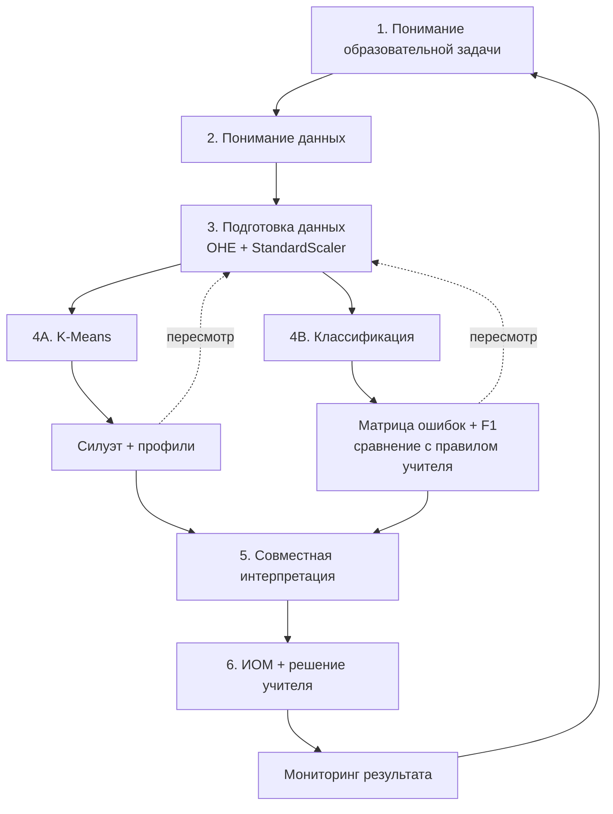
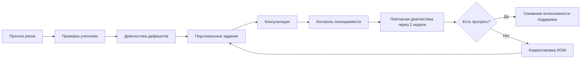

# Лабораторная работа № 2

## Кластеризация учебных траекторий и прогнозирование академического риска

**Дисциплина:** «К.М.06.04 Методы анализа больших данных»  
**Профиль:** «Информатика и английский язык»  
**Трудоёмкость:** 10 академических часов  
**Компетенция:** ПК-1.2  
**Среда:** Google Colab, Python 3.10+  
**Датасет:** UCI Student Performance, `student-mat.csv` (разделитель `;`)  
**Максимум:** 20 баллов

| Файл | Назначение |
|---|---|
| `lw_02_student.ipynb` | рабочий ноутбук студента: почти весь код готов, дописать нужно 6 коротких строк |
| `lw_02_solution_v_25.ipynb` | эталонное решение варианта 25 для преподавателя: выполнено, с примерами ответов |
| `lw_02.md` | это описание |

> **О ссылке на данные.** Адрес из исходного задания
> `https://raw.githubusercontent.com/arunkumar-ramanan/student-performance-dataset/master/student-mat.csv`
> сейчас возвращает ошибку `404`. Ноутбук пробует его первым, затем автоматически берёт резервную копию того же файла
> `https://raw.githubusercontent.com/sachanganesh/student-performance-prediction/refs/heads/master/data/student-mat.csv`,
> а при её недоступности — официальный архив UCI `https://archive.ics.uci.edu/static/public/320/student+performance.zip`.
> Скачивать файл вручную не нужно.

---

## 1. Паспорт работы

### Цель

Пройти полный цикл анализа образовательных данных по CRISP-DM: подготовить смешанные признаки, найти учебные профили методом K-Means, построить модель прогноза итоговой оценки `G3`, честно оценить её качество и превратить результат в проект индивидуального образовательного маршрута (ИОМ), который проверяет и утверждает учитель.

### Задачи

1. Загрузить UCI Student Performance по HTTPS без ручной загрузки.
2. Проверить качество данных и разделить признаки на числовые и категориальные.
3. Выполнить One-Hot Encoding и StandardScaler.
4. Подобрать число кластеров по методу локтя и коэффициенту силуэта.
5. Описать профили кластеров в исходных шкалах.
6. Выделить группу повышенного педагогического внимания и проверить её по фактическому `G3`.
7. Построить классификатор своего варианта.
8. Рассчитать матрицу ошибок, Precision, Recall и $F_1$; сравнить модель с простым правилом учителя.
9. Интерпретировать важность признаков и проверить модель без социально-демографических признаков.
10. Спроектировать ИОМ для одного учащегося прогнозируемой группы риска.

### Что важно понять до начала

Главное в работе — **не программирование, а интерпретация**. Код почти полностью готов; оценивается то, насколько корректно вы объясните числа и насколько педагогически ответственно используете прогноз. Студент дописывает только номер варианта, выбор числа кластеров и четыре короткие строки кода по подсказкам.

---

## 2. Как устроен рабочий ноутбук

| Что видите в ячейке | Что сделать |
|---|---|
| `V = None` | вписать номер варианта целым числом, например `V = 7` |
| `...` и справа `# ← впишите: …` | заменить три точки кодом из подсказки |
| сообщение `Не заполнено (…)` | вернуться к названной строке и заменить `...` |
| «Ячейка готова — просто запустите» | ничего не менять, нажать **Shift + Enter** |
| «Как читать результат» | прочитать перед выводом |
| «Что получено» | дописать предложения-заготовки своими числами |

Если появилась ошибка `NameError: name '…' is not defined`, значит, не запущена одна из предыдущих ячеек: **Runtime → Run before**.

| Шаг ноутбука | Что делает студент | Критерий |
|---|---|---|
| 0. Студент и вариант | ФИО, группа, `V`; гипотеза до обучения | — |
| 1. Загрузка | запускает ячейку | — |
| 2. Проверка качества | записывает числа в «Что получено» | 5 баллов (шаги 2–5) |
| 3. Подготовка признаков | **TODO 1:** `StandardScaler()`, `make_ohe()` | |
| 4. Выбор `k` | **TODO 2:** выбирает `k` по графикам и обосновывает | |
| 5. Профили кластеров | описывает группы без ярлыков, проверяет по `G3` | |
| 6. Цель и разбиение | **TODO 3–4:** убирает `G3` из признаков, `stratify=y` | 5 баллов (шаги 6–7) |
| 7. Модель варианта | запускает ячейку | |
| 8. Оценка | интерпретирует матрицу ошибок и сравнение с правилом учителя | 4 балла (шаги 8–9) |
| 9. Важность признаков | объясняет, почему важность не причина | |
| 10. ИОМ | заполняет ИОМ для одного учащегося | 4 балла |
| 11. Самопроверка | все пункты `OK`, итоговый вывод | — |

---

## 3. Методология CRISP-DM в образовании



---

## 4. Теоретический минимум с пояснениями

### K-Means: «раскладываем учеников по похожести»

Алгоритм выбирает $k$ центров, относит каждого ученика к ближайшему центру, затем переносит центры в середину своих групп и повторяет, пока группы не перестанут меняться. Он минимизирует сумму квадратов расстояний до центров:

$$
J = \sum_{j=1}^{k} \sum_{x_i \in C_j} \lVert x_i - c_j \rVert^2 .
$$

Здесь $c_j$ — центроид кластера $j$. Величина `inertia_` в scikit-learn — это и есть $J$. При росте $k$ она **всегда** уменьшается, поэтому одной инерции для выбора $k$ недостаточно.

### StandardScaler: зачем масштабировать

$$
z=\frac{x-\mu}{\sigma}.
$$

K-Means сравнивает расстояния. Пропуски `absences` меняются от 0 до 75, а `studytime` — от 1 до 4; без масштабирования группы определялись бы почти только пропусками. После стандартизации у каждого признака среднее 0 и стандартное отклонение 1. Категориальные признаки переводятся в числа One-Hot кодированием: `internet = yes` → `internet_no = 0`, `internet_yes = 1`.

### Коэффициент силуэта

$$
s(i) = \frac{b(i) - a(i)}{\max(a(i), b(i))},
$$

где $a(i)$ — среднее расстояние до объектов собственного кластера, $b(i)$ — минимальное среднее расстояние до объектов другого кластера. Значения от −1 до 1. Для анкетных данных о людях типичны значения 0,1–0,3: группы размыты, граница условная. Это **не «естественные типы учеников»**, а удобное деление для анализа.

**Как выбирать $k$:** сопоставить три аргумента — «локоть» инерции, максимум силуэта и интерпретируемость (сможет ли учитель описать каждую группу словами; нет ли групп из 5–15 человек).

### Цели прогноза

$$
risk=
\begin{cases}
1, & G3<10,\\
0, & G3\geq10.
\end{cases}
\qquad
grade(G3)=
\begin{cases}
A, & 16\leq G3\leq20,\\
B, & 14\leq G3\leq15,\\
C, & 10\leq G3\leq13,\\
F, & 0\leq G3\leq9.
\end{cases}
$$

Оценки — по 20-балльной португальской шкале, 10 — порог «сдал». Шкала A/B/C/F — учебная, только для этой работы. Итоговый `G3 = 0` при ненулевых `G1`, `G2` обычно означает неявку на аттестацию, а не нулевые знания.

### Метрики классификации

| | прогноз «нет риска» | прогноз «риск» |
|---|---|---|
| на самом деле нет риска | TN | FP — лишняя консультация |
| на самом деле риск | **FN — ученик остался без помощи** | TP |

$$
Accuracy = \frac{TP+TN}{TP+TN+FP+FN},\qquad
Precision = \frac{TP}{TP+FP},\qquad
Recall = \frac{TP}{TP+FN},\qquad
F_1 = 2 \cdot \frac{P \cdot R}{P + R}.
$$

Для многоклассовой задачи (A/B/C/F):

$$
F_1^{macro}=\frac{1}{K}\sum_{k=1}^K F_{1,k}.
$$

**Почему Accuracy недостаточно.** В данных риск у 33 % учащихся; «модель», которая всегда отвечает «нет риска», уже получает Accuracy 67 %, не найдя ни одного ученика с риском. Для системы раннего предупреждения важнее Recall класса риска, но при очень низком Precision учитель утонет в ложных сигналах.

**Сравнение с правилом учителя.** В ноутбуке модель сравнивается с правилом «последняя известная оценка ниже 10» (`G2 < 10`; для варианта 11 — `G1 < 10`). Если модель с десятками признаков не лучше этого правила, её сложность не оправдана — это корректный и ценный вывод, а не провал.

---

## 5. Общий алгоритм

1. Загрузить `student-mat.csv` с `sep=';'`.
2. Проверить структуру, `NaN`, дубликаты, диапазоны и нули в `G1–G3`.
3. Взять признаки кластеризации своего варианта.
4. Числовые признаки масштабировать, категориальные кодировать One-Hot.
5. Для $k=2..8$ вычислить `inertia_` и коэффициент силуэта.
6. Выбрать $k$, сопоставив локоть, силуэт и интерпретируемость.
7. Обучить итоговый K-Means.
8. Построить профиль кластеров в исходных шкалах.
9. Определить кластер повышенного внимания по учебным признакам (низкие `G1`, `G2`; высокие `failures`, `absences`).
10. Проверить интерпретацию по доле `G3 < 10` — **только после кластеризации**.
11. Создать целевую переменную классификации и исключить `G3` и производные от него столбцы из признаков.
12. Выполнить стратифицированное `train_test_split` (25 % — тест, `random_state=42`).
13. Обучить модель своего варианта.
14. Рассчитать матрицу ошибок, Classification Report и сравнить с правилом учителя.
15. Интерпретировать $F_1$ и Recall класса риска.
16. Построить важность признаков; проверить модель без социально-демографических признаков.
17. Сформировать ИОМ и сформулировать ограничения применения модели.

---

## 6. Варианты заданий

| № | Набор признаков для кластеризации | Целевая переменная | Алгоритм | Гиперпараметры | Педагогический кейс: ИОМ |
|---:|---|---|---|---|---|
| 1 | `studytime`, `failures`, `G1`, `G2` | Бинарный риск: `G3 < 10` | Decision Tree | `max_depth=3`, `min_samples_leaf=8` | Диагностика дефицитов и еженедельный контроль. |
| 2 | `studytime`, `failures`, `absences`, `G1`, `G2` | Бинарный риск: `G3 < 10` | Logistic Regression | `C=0.5`, `class_weight='balanced'` | Контроль посещаемости и календарь контрольных точек. |
| 3 | `freetime`, `goout`, `Dalc`, `Walc`, `absences` | Градация `A/B/C/F` | Random Forest | `n_estimators=200`, `max_depth=6` | Саморегуляция учебного времени и мониторинг посещаемости. |
| 4 | `Medu`, `Fedu`, `famrel`, `famsize`, `Pstatus` | Бинарный риск: `G3 < 10` | KNN | `n_neighbors=9`, `weights='distance'` | Поддержка без социальных ярлыков, опора на доступные ресурсы. |
| 5 | `G1`, `G2`, `failures`, `schoolsup`, `paid` | Градация `A/B/C/F` | Decision Tree | `max_depth=5`, `min_samples_split=12` | Дифференцированные задания по текущим достижениям. |
| 6 | `studytime`, `higher`, `failures`, `G1`, `G2` | Бинарный риск: `G3 < 10` | Random Forest | `n_estimators=250`, `max_depth=5`, `class_weight='balanced'` | Мотивационный модуль и предметные консультации. |
| 7 | `absences`, `traveltime`, `freetime`, `goout`, `studytime` | Бинарный риск: `G3 < 10` | Logistic Regression | `C=1.0`, `class_weight='balanced'` | Планирование времени и контроль посещаемости. |
| 8 | `schoolsup`, `famsup`, `paid`, `internet`, `activities`, `G1` | Градация `A/B/C/F` | Random Forest | `n_estimators=300`, `max_depth=7` | Подбор бесплатных цифровых и очных форм поддержки. |
| 9 | `Medu`, `Fedu`, `studytime`, `failures`, `G1` | Бинарный риск: `G3 < 10` | Decision Tree | `max_depth=4`, `class_weight='balanced'` | Индивидуальные цели без выводов о способностях по семейным факторам. |
| 10 | `goout`, `Walc`, `absences`, `G1`, `G2` | Градация `A/B/C/F` | KNN | `n_neighbors=11`, `weights='distance'`, `p=2` | Анализ режима и регулярности учебной работы. |
| 11 | `studytime`, `failures`, `absences`, `G1` | Бинарный риск: `G3 < 10` | Logistic Regression | `C=0.2`, `class_weight='balanced'` | Раннее вмешательство после первого периода. |
| 12 | `school`, `reason`, `schoolsup`, `activities`, `internet`, `G1` | Градация `A/B/C/F` | Random Forest | `n_estimators=200`, `max_depth=8` | Маршрутизация к школьным ресурсам. |
| 13 | `famrel`, `famsup`, `Medu`, `Fedu`, `studytime`, `G1` | Бинарный риск: `G3 < 10` | KNN | `n_neighbors=7`, `weights='uniform'`, `p=1` | Подбор форм обратной связи и учебных ресурсов. |
| 14 | `freetime`, `goout`, `Dalc`, `Walc`, `health`, `absences` | Градация `A/B/C/F` | Decision Tree | `max_depth=4`, `min_samples_leaf=10` | Работа с учебным режимом без медицинских интерпретаций. |
| 15 | `studytime`, `internet`, `higher`, `G1`, `G2` | Бинарный риск: `G3 < 10` | Random Forest | `n_estimators=250`, `max_features='sqrt'`, `class_weight='balanced'` | Офлайн/онлайн ресурсы и задания разного уровня. |
| 16 | `absences`, `failures`, `schoolsup`, `G1`, `G2` | Градация `A/B/C/F` | Logistic Regression | `C=2.0`, `max_iter=2000` | Консультации и восстановление пропущенных тем. |
| 17 | `address`, `traveltime`, `goout`, `freetime`, `internet` | Бинарный риск: `G3 < 10` | Decision Tree | `max_depth=3`, `min_samples_leaf=12` | Реалистичный график и доступность ресурсов. |
| 18 | `G1`, `G2`, `studytime`, `failures`, `absences` | Бинарный риск: `G3 < 10` | KNN | `n_neighbors=5`, `weights='distance'`, `p=2` | Персональные задания по близким учебным профилям. |
| 19 | `schoolsup`, `famsup`, `paid`, `studytime`, `G1`, `G2` | Градация `A/B/C/F` | Random Forest | `n_estimators=400`, `max_depth=6`, `min_samples_leaf=2` | Сопоставление вида поддержки и учебного профиля. |
| 20 | `higher`, `studytime`, `activities`, `goout`, `absences`, `G1` | Бинарный риск: `G3 < 10` | Logistic Regression | `C=0.8`, `class_weight='balanced'` | Учебная цель, план недели и короткая обратная связь. |
| 21 | `studytime`, `failures`, `famsup`, `famrel`, `G1`, `G2` | Градация `A/B/C/F` | Decision Tree | `max_depth=6`, `min_samples_leaf=6` | Задания разной сложности и формирующее оценивание. |
| 22 | `school`, `reason`, `traveltime`, `studytime`, `G1`, `G2` | Бинарный риск: `G3 < 10` | Random Forest | `n_estimators=300`, `max_depth=5`, `class_weight='balanced_subsample'` | Адаптация графика и школьная поддержка. |
| 23 | `freetime`, `goout`, `absences`, `failures`, `G1`, `G2` | Градация `A/B/C/F` | KNN | `n_neighbors=13`, `weights='distance'`, `p=2` | Планирование нагрузки по профилю группы. |
| 24 | `studytime`, `failures`, `schoolsup`, `famsup`, `higher`, `internet`, `G1`, `G2` | Бинарный риск: `G3 < 10` | Logistic Regression | `C=1.5`, `class_weight='balanced'`, `max_iter=2000` | Комбинированная поддержка: контент, консультация, контроль. |
| 25 | `studytime`, `failures`, `absences`, `goout`, `Walc`, `famrel`, `higher`, `schoolsup`, `famsup`, `internet`, `G1`, `G2` | Бинарный риск: `G3 < 10` | Random Forest | `n_estimators=300`, `max_depth=6`, `min_samples_leaf=3`, `class_weight='balanced'` | Диагностика дефицитов, персональные задания, консультации и двухнедельный мониторинг. |

**Общее для всех вариантов.**

* Классификатор получает все исходные поля, кроме `G3` и производных от него столбцов. Так как в признаках есть `G1` и `G2`, это сценарий прогноза **после второго учебного периода**.
* **Вариант 11:** кейс — «раннее вмешательство после первого периода», поэтому `G2` из признаков классификатора исключается (на момент прогноза его ещё нет), а правило учителя строится по `G1`.
* В алгоритмах с элементом случайности фиксируется `random_state=42`; для логистической регрессии по умолчанию `max_iter=2000`.
* Признаки о семье, алкоголе и здоровье (варианты 3, 4, 9, 10, 13, 14) используются **только для анализа групп**. Выводы о конкретном ученике по ним делать нельзя; в ИОМ они не фигурируют.

---

## 7. Пример выполнения: вариант № 25

### Условие

**Кластеризация.** Числовые признаки — `studytime, failures, absences, goout, Walc, famrel, G1, G2`; категориальные — `higher, schoolsup, famsup, internet`. Предобработка: `StandardScaler` и `OneHotEncoder(handle_unknown="ignore")`. Подбор $k = 2..8$ по методу локтя и силуэту.

**Профилирование.** Для каждого кластера: размер; средние `G1`, `G2`; медиана `absences`; средние `studytime`, `failures`, `goout`, `Walc`, `famrel`; доли `higher`, `schoolsup`, `famsup`, `internet` со значением `yes`. Фактическая доля `G3 < 10` — только после кластеризации, как внешняя проверка.

**Классификация.** $risk=1 \Leftrightarrow G3<10$;

```python
RandomForestClassifier(n_estimators=300, max_depth=6, min_samples_leaf=3,
                       class_weight="balanced", random_state=42)
```

### Ориентиры эталонного прогона

| Показатель | Значение |
|---|---|
| учащихся / пропусков / дубликатов | 395 / 0 / 0 |
| с риском `G3 < 10` | 130 (32,9 %) |
| нулевых `G3` / `G2` | 38 / 13 |
| максимальный силуэт | 0,166 при $k = 2$ |
| размеры кластеров | 166 и 229 |
| группа повышенного внимания | кластер 0: средние G1 = 8,1, G2 = 7,7; доля `G3 < 10` — 68,7 % (в кластере 1 — 7,0 %) |
| train / test | 296 / 99 |
| Random Forest: Accuracy / F1 риска / Recall / Precision | 0,899 / 0,857 / 0,909 / 0,811 |
| матрица ошибок | TN = 59, FP = 7, FN = 3, TP = 30 |
| правило учителя `G2 < 10`: Accuracy / F1 | 0,909 / 0,870 |
| самые важные признаки | `G2` 0,37; `G1` 0,26; `failures` 0,04 |
| F1 без социально-демографических признаков | 0,845 |
| прогнозируемая группа риска в тесте | 37 учащихся, из них фактически `G3 < 10` — 30 |

**Главный вывод примера.** Случайный лес не превосходит простое правило «`G2` ниже 10»: модель опирается в основном на текущие оценки. Её практическая польза — в упорядочивании учащихся по вероятности риска и в напоминании проверить остальные признаки, а не в «открытии» новых причин.

---

## 8. Педагогический кейс: ИОМ



| Компонент ИОМ | Содержание | Пример (учащийся S012 из эталона) |
|---|---|---|
| Основание | учебные показатели, требующие педагогической проверки | G1 = 6, G2 = 7, 15 пропусков |
| Цель | конкретный результат на 2 недели | восстановить 2 темы, проверочная работа ≥ 6 из 10 |
| Диагностика | короткая диагностическая работа | 15 минут по темам второго периода |
| Учебный контент | 2–3 персональных задания | по 3 задания возрастающей сложности с образцом |
| Поддержка | консультация / парная работа / цифровой ресурс | 2 консультации по 20 минут, работа в паре |
| Посещаемость | план восстановления пропущенных тем | одна тема в неделю + мини-задание |
| Контроль | формирующее оценивание | тест в конце недели, обратная связь в тот же день |
| Критерий прогресса | измеримое улучшение | +2 балла из 10 по диагностике |
| Пересмотр | повторная оценка через 14 дней | при прогрессе — реже консультации, без прогресса — корректировка |

**Недопустимо** использовать риск-модель для автоматического снижения оценки, ограничения доступа к сложным заданиям, решений по полу, семье или образованию родителей, а также формулировки «неспособный», «слабый ученик».

Корректно: *The model indicates an elevated academic risk; the case should be reviewed by the teacher.*  
Некорректно: *The model proves that the student is weak and will fail.*

---

## 9. Критерии оценивания

| Критерий | Баллы | Что проверяется |
|---|---:|---|
| Предобработка, масштабирование и K-Means | 5 | заполнены TODO 1–2; выбор $k$ обоснован тремя аргументами; группы описаны в исходных шкалах без ярлыков; есть внешняя проверка по `G3` |
| Построение и обучение классификатора | 5 | `G3` исключён, разбиение стратифицировано, модель варианта обучена, сценарий применения назван верно |
| Матрица ошибок, $F_1$ и интерпретация | 4 | интерпретированы FN и FP; есть сравнение с правилом учителя; важность не выдаётся за причину |
| Педагогический кейс: ИОМ | 4 | ИОМ измеримый, без ярлыков и чувствительных признаков; решение остаётся за учителем |
| Защита и контрольные вопросы | 2 | ответы на 2–3 вопроса из раздела 11 |
| **Итого** | **20** | |

---

## 10. Что сдать

* выполненный `lw_02_student.ipynb` (после **Runtime → Restart and run all**) или ссылку на Google Colab с доступом для просмотра;
* заполненные блоки «Что получено», гипотезу, ИОМ и итоговый вывод в самом ноутбуке;
* все графики (локоть и силуэт, профили, матрица ошибок, важность признаков) должны быть видны в сохранённом ноутбуке;
* самопроверка (шаг 11) — все пункты `OK`.

---

## 11. Контрольные вопросы и ориентиры ответов

| Вопрос | Ориентир ответа |
|---|---|
| 1. Почему K-Means требует масштабирования? | алгоритм сравнивает расстояния; признак с большим разбросом (пропуски) иначе подавит остальные |
| 2. Что означает `inertia_`? | сумма квадратов расстояний объектов до центров своих кластеров; уменьшается с ростом $k$ |
| 3. Чем метод локтя отличается от силуэта? | локоть смотрит только на плотность групп; силуэт — ещё и на отделённость от соседних групп |
| 4. Почему нельзя включать `G3` в признаки? | это ответ; модель «подсмотрит» его, и качество будет ложно высоким (утечка данных) |
| 5. В каком сценарии допустимы `G1` и `G2`? | только после второго периода, когда обе оценки уже выставлены |
| 6. Почему Accuracy недостаточно при дисбалансе? | ответ «никто не рискует» даёт высокую Accuracy при нулевом Recall |
| 7. Почему FN особенно важен для системы раннего предупреждения? | пропущенный ученик с риском не получит помощи вовремя; лишняя консультация (FP) почти не вредит |
| 8. Что важность признаков не позволяет утверждать? | что признак является причиной; она описывает только решения данной модели на данных наблюдения |
| 9. Почему кластер нельзя называть «слабыми учениками»? | это условная группа по нескольким показателям, силуэт низкий; ярлык стигматизирует и не следует из данных |
| 10. Почему ИОМ должен подтверждаться преподавателем? | модель не знает контекста (болезнь, неявка, семейные обстоятельства) и ошибается; ответственность за решение — у педагога |
